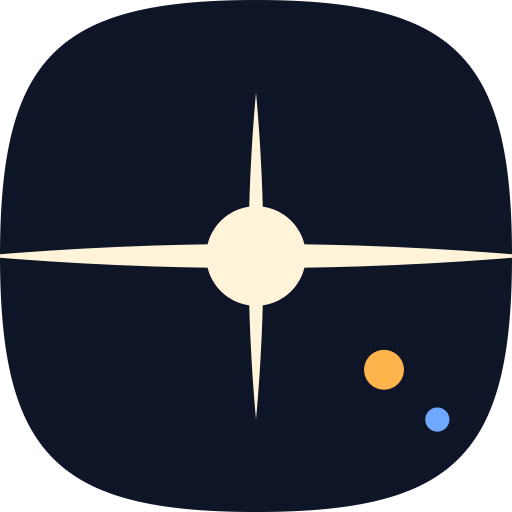

<p align="center">
  
</p>

<h1 align="center">Lumen</h1>

<p align="center">
  A photo gallery for Android that finds your photos by what is in them.<br>
  All of the smart features work on your phone. Your photos never go to a server.
</p>

<p align="center">
  <a href="LICENSE"></a>
  
</p>

Lumen shows the photos and videos that are on your phone. It can also find a photo from a
description, read the text in your photos, and put the photos of each person together. Lumen
does all of this work on the phone. It has no account, no advertisements, and no analytics.
Lumen costs nothing and its source code is open.

## Contents

- [Features](#features)
- [Privacy](#privacy)
- [Requirements](#requirements)
- [Install Lumen](#install-lumen)
- [Smart features](#smart-features)
- [Permissions](#permissions)
- [Build Lumen from the source code](#build-lumen-from-the-source-code)
- [Report a bug](#report-a-bug)
- [License](#license)

## Features

### Library and albums

- See all of your photos and videos in one grid. The newest photo is at the bottom.
- Pinch the grid to show more or fewer columns.
- Show the photos by year or by month.
- See each folder on your phone as an album. Sort, pin, rename, and set the cover of an album.
- Open Favorites, Videos, Screenshots, and Recently Deleted from Collections.
- Hide folders that you do not want to see, for example folders of app icons.

### Viewer

- Swipe between photos. Swipe down to close a photo. Swipe up to see its details.
- See the date, the camera data, the file data, and the place where you took the photo.
- See a map of the place, if you turn on Maps.
- Use the film strip at the bottom to move quickly through many photos.
- Zoom into photos and videos.
- See Ultra HDR photos with their full brightness on phones that have a high dynamic range (HDR)
  screen.
- Play videos at a different speed. Double tap a video to pause it or to skip 10 seconds.
- Start a slideshow.

### Tools

- Share, copy, move, rename, rotate, and resize photos.
- Change the date of a photo.
- Set a photo as the wallpaper.
- Let other apps open photos in Lumen. Let other apps get photos from Lumen.
- Bring your favorites from Fossify Gallery or Aves.
- Export your Lumen settings to a file, and import them again.

### Hidden photos and locks

- Hide photos and folders in Hidden. Lumen uses the same hidden files as Fossify Gallery.
- Lock Hidden with a PIN, a pattern, or a password, and unlock it with your fingerprint or face.
- Encrypt the photos in Hidden, if you turn on Encrypt Hidden.
- Lock all of Lumen with the App Lock.

## Privacy

Lumen does its work on your phone. It does not send your photos, their data, or your personal data to
a server. Lumen uses the internet for 3 tasks only:

| Task | Server | When |
|---|---|---|
| Download the models for the smart features | Hugging Face | Only when you tap Download in Settings, or in the first setup |
| Show map tiles | OpenFreeMap | When Maps is on and you open the details of a photo that has a place |
| Look for a new version of Lumen | GitHub | Once each day if Check Automatically is on, or when you tap Software Update |

You can turn off Maps and Check Automatically in Settings. Lumen never asks for the location of
your phone. It reads only the location that the camera put in each photo.

## Requirements

- An Android phone with Android 11 or later.
- For the smart features, space on the phone for the models. The models need about 340 MB with
  the Fast search model, or about 770 MB with the Accurate search model.

The smart features are optional. Lumen works as a gallery without them.

## Install Lumen

Lumen is available as an APK file, the Android package file, on the
[Releases page](https://github.com/subhashhhhhh/Lumen/releases). Lumen is not on F-Droid or
Google Play yet.

1. Open the [Releases page](https://github.com/subhashhhhhh/Lumen/releases) on your phone.
2. Download the APK file of the latest release.
3. Open the APK file.
4. If Android asks, let your browser install apps.
5. Tap Install.

When a new version is available, Lumen shows it at the top of Settings. To install it, go to
Settings, then About, then Software Update.

## Smart features

The smart features use models. A model is a file that lets the phone recognize the contents of a
photo. Lumen does not include the models in the app. Lumen downloads them when you ask for them.

| Feature | What it does | Model |
|---|---|---|
| Smart Search | Finds photos from a description, for example "cat on a sofa" | SigLIP 2 for Accurate, or OpenCLIP for Fast |
| Text in photos | Finds photos from the words in them. Lets you select and copy text in a photo | PP-OCRv6 |
| People | Finds faces and puts the photos of each person together | YuNet and SFace |
| Subtitles | Writes subtitles for the speech in your videos | Whistle and Silero VAD |

After the download, Lumen makes an index of your photos. By default, this work occurs only
while your phone charges. Lumen stops the work when the phone gets warm, and starts again later.
You can also set a time of night for this work in Scheduled Indexing.

The models are on [Hugging Face](https://huggingface.co/subhashhhhhh). Each model has a fixed
version. Lumen does a check of each file with its SHA-256 checksum before it uses the file.

## Permissions

| Permission | Why Lumen needs it |
|---|---|
| Photos and videos | To show the photos and videos on your phone |
| All files access, optional | To show hidden files and folders, and to change favorites quickly |
| Media management, optional | To delete and to mark favorites without a question from Android each time |
| Location in photos | To read the place where you took a photo |
| Notifications | To show the progress of a download or of the index |
| Fingerprint or face | To unlock Hidden and the App Lock |
| Install apps | To install a new version of Lumen from Software Update |
| Wallpaper | To set a photo as the wallpaper |
| Internet | For the tasks in [Privacy](#privacy) |

## Build Lumen from the source code

You need these tools:

- The Java Development Kit (JDK) 17 or later.
- The Android Software Development Kit (SDK) with Android platform 37.

Do these steps:

1. Get the source code:

   ```sh
   git clone https://github.com/subhashhhhhh/Lumen.git
   cd Lumen
   ```

2. Build the debug APK:

   ```sh
   ./gradlew :app:assembleDebug
   ```

3. Install the APK on a phone that has USB debugging on:

   ```sh
   adb install app/build/outputs/apk/debug/app-debug.apk
   ```

The debug app has a different app ID, `com.subhashh.lumen.debug`. It does not replace a release
version of Lumen.

The `tools` folder has the Python scripts that make the model files. You do not need them to
build the app.

## Report a bug

1. Open the [Issues page](https://github.com/subhashhhhhh/Lumen/issues).
2. Do a search for an issue with the same problem.
3. If no issue has the same problem, open a new issue.
4. Write the version of Lumen. You can find it in Settings, then About.
5. Write the name of your phone and the version of Android.
6. Write the steps that cause the problem.

You can also open the Issues page from Lumen. Go to Settings, then About, then Report a Bug.

## License

Lumen is open source under the [Apache License 2.0](LICENSE). Copyright 2026 Subhash Gottumukkala.

Lumen uses the work of many open source projects, for example Backdrop by Kyant0, Coil,
Telephoto, Media3, ONNX Runtime, LiteRT, and MapLibre. The place names come from GeoNames, and
the map data comes from OpenStreetMap. For the full list and the licenses, see [NOTICE](NOTICE)
and Settings, then About, then Open-Source Licenses.
